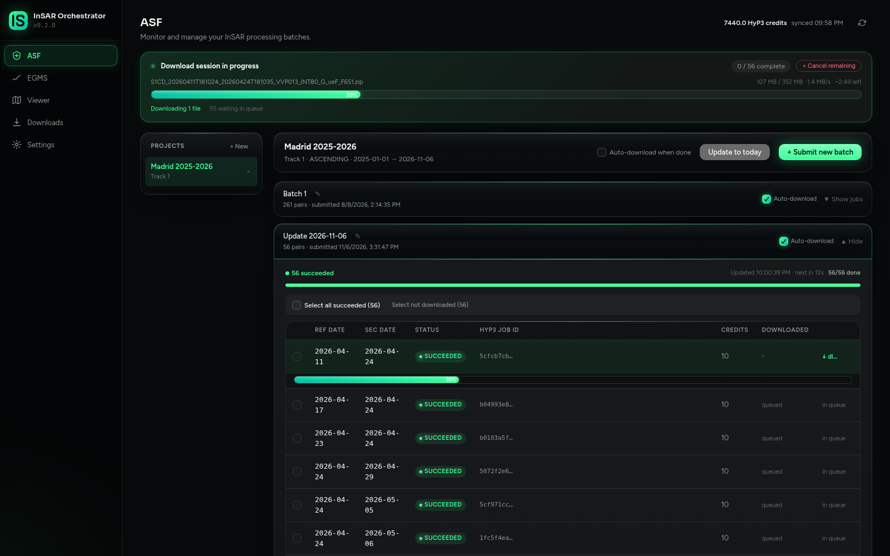
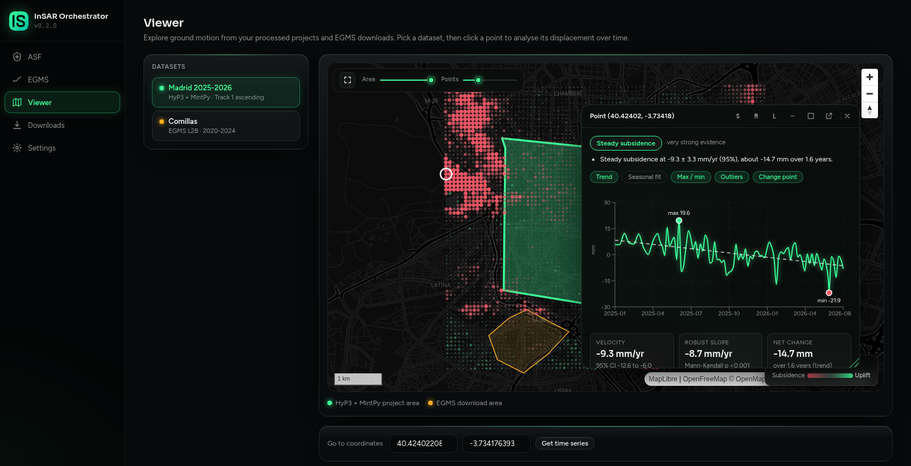
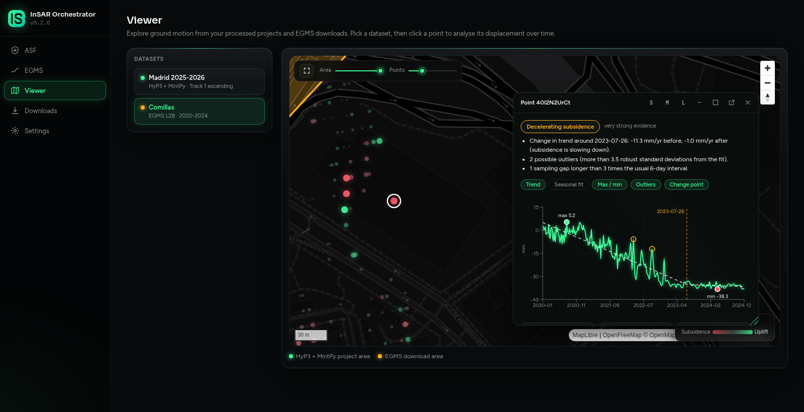
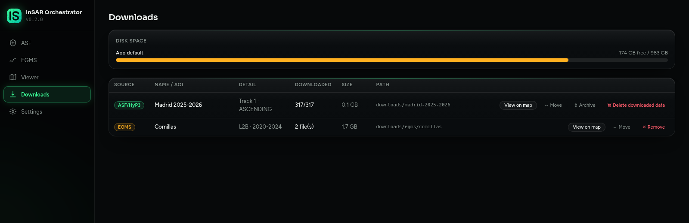

[](https://github.com/JSempereH/InSAR-Orchestrator/actions/workflows/ci.yml)
[](LICENSE)

A self-hosted, end-to-end InSAR processing platform for Sentinel-1 data. Instead of navigating ASF, HyP3, or ESGM dashboards separately, this tool centralises everything: draw an area on a map, discover available satellite tracks, submit interferometric pairs to HyP3 for cloud processing, monitor jobs in real time, and prepare results for MintPy SBAS analysis, all from a single web UI. You can also pick a point on the map and pull up its displacement time series, either from a downloaded EGMS (Copernicus Ground Motion Service) product or from a finished MintPy SBAS run.

This tool is designed with research in mind. This is **not** a production tool, no warranty guaranteed.

[](docs/images/pipeline.mp4)

**New here? Read the [Guide](docs/guide.md).**


---

## Architecture

```
insar-orchestrator/
├── packages/insar_core/   # Core Python library (pip-installable)
│   ├── adapters/          # ASF scene/track search, HyP3 job submission, EGMS product search
│   ├── models/            # Pure dataclasses: SARScene, AOI, Job, EGMS search params
│   ├── pipeline/          # SBAS pair builder, orchestrator, MintPy adapter + time series reader
│   ├── credentials.py     # Earthdata / EGMS credential resolution (explicit -> env vars -> ~/.netrc)
│   └── net.py             # Shared HTTP download helper (retry with backoff, resume via Range)
├── backend/               # FastAPI REST API + WebSocket
│   └── app/
│       ├── routers/       # projects, batches, jobs, scenes, slc, egms, mintpy, storage, credentials
│       └── services/      # ASF/HyP3/EGMS integration, background download queues, polling, encryption
└── frontend/              # React 18 + Vite SPA
    └── src/
        ├── components/    # AOI/downloads maps (MapLibre), job monitor, SLC panel, project wizard
        └── pages/         # Dashboard (ASF/HyP3), Ground Motion (EGMS), Viewer, Downloads, Settings
```

This repo is scoped to InSAR: draw an AOI, discover tracks, submit pairs to
HyP3, monitor jobs, run MintPy SBAS on the results.

---

## Prerequisites

| Tool | Version | Notes |
|---|---|---|
| Python | ≥ 3.11 | For backend + core library |
| Node.js | ≥ 18 | For frontend |
| MintPy | ≥ 1.6.3 | Only needed for local SBAS analysis. It is found on `PATH` or in `backend/.venv` (`uv pip install --python backend/.venv mintpy`) |
| NASA Earthdata account | — | Free at [urs.earthdata.nasa.gov](https://urs.earthdata.nasa.gov/users/new) |

---

## Setup

### Quick start

Requires [`uv`](https://docs.astral.sh/uv/getting-started/installation/) and Node.js ≥ 18 to be installed. Then:

```bash
git clone <repo-url> insar-orchestrator
cd insar-orchestrator
./setup.sh   # creates backend/.venv, installs backend + insar_core + frontend deps, prepares backend/.env
./dev.sh     # runs backend (:8000) and frontend (:5173) together, Ctrl+C stops both
```

That's it, skip to [step 3](#3-configure-earthdata-credentials) below to set up Earthdata credentials. The manual steps below are kept as a reference (e.g. for Windows, or if you don't want to use `uv`).

### 1. Clone and install the core library

```bash
git clone <repo-url> insar-orchestrator
cd insar-orchestrator
```

The `insar_core` library must be installed in the same Python environment as the backend:

```bash
cd backend
python -m venv .venv
source .venv/bin/activate        # Windows: .venv\Scripts\activate
pip install -r requirements.txt  # installs insar-core from ../packages/insar_core
```

### 2. Configure backend environment

Create `backend/.env` (never commit this file):

```bash
# backend/.env

# Optional: persistent encryption key for stored credentials.
# If omitted, a new key is generated each restart (credentials reset).
# Generate once and paste here:
#   python -c "from cryptography.fernet import Fernet; print('SECRET_KEY=' + Fernet.generate_key().decode())"
SECRET_KEY=

# Optional overrides (defaults shown):
# DATABASE_URL=sqlite:///./insar_app.db
# DOWNLOADS_DIR=./downloads
```

### 3. Configure Earthdata credentials

**Option A: environment variables (recommended for development):**

```bash
export EARTHDATA_USER=your_username
export EARTHDATA_PASS=your_password
```

**Option B: `~/.netrc`** (standard NASA tool format):

```
machine urs.earthdata.nasa.gov
    login your_username
    password your_password
```

```bash
chmod 600 ~/.netrc
```

**Option C: web UI** (Settings page): credentials are encrypted with Fernet before being stored in the database. Note this is a **research** tool. It is not intended for production, so do not expect production-grade security.

### 4. Configure EGMS credentials (optional, for Ground Motion / EGMS features)

Only needed if you want to search and download Copernicus European Ground Motion
Service products (the "Ground Motion" page) - not required for the ASF/HyP3 side.

1. Generate a service-account key from your [CLMS account](https://land.copernicus.eu) page.
   It's a JSON file with `client_id`, `user_id`, `token_uri`, and `private_key`.
2. Open the app's **Settings** page and paste the full JSON into the "Copernicus EGMS" card.
   Like Earthdata credentials, it's encrypted with Fernet before being stored.

There is no environment-variable/`~/.netrc` equivalent for the web app - the backend
only reads EGMS credentials from the database. (The standalone library does support
an env-var-pointed key file; see `insar_core.credentials.load_egms_service_key` below.)

---

## Running the backend

```bash
cd backend
source .venv/bin/activate
uvicorn app.main:app --reload --host 0.0.0.0 --port 8000
```

The API will be available at `http://localhost:8000`. Interactive docs at `http://localhost:8000/docs`.

Key endpoints (see `/docs` for the full, generated list):

| Method | Path | Description |
|---|---|---|
| GET | `/api/health` | Health check |
| POST | `/api/projects` | Create a project (AOI + parameters) |
| GET | `/api/projects` | List all projects |
| POST | `/api/scenes/tracks` | Available tracks for an AOI + date range |
| POST | `/api/scenes/search` | Search ASF for Sentinel-1 scenes |
| POST | `/api/projects/{id}/batches` | Plan (dry run) or submit a batch of SBAS pairs to HyP3 |
| GET | `/api/projects/{id}/batches/{batch_id}/jobs` | List jobs in a batch |
| POST | `/api/downloads/queue` | Queue one or more succeeded HyP3 jobs' outputs for download |
| POST | `/api/projects/{id}/slc/downloads/queue` | Queue raw Sentinel-1 SLC scenes for direct ASF download |
| POST | `/api/egms/search` | Search EGMS ground-motion products covering an AOI |
| POST | `/api/egms/downloads/queue` | Queue EGMS products for download |
| GET | `/api/egms/downloads/{id}/points` | Downloaded EGMS product as GeoJSON points (velocity per point), for map display |
| GET | `/api/egms/downloads/{id}/points/{point_id}/timeseries` | Displacement time series for one point, with its statistical summary in `analysis` (L2A/L2B downloads only) |
| GET | `/api/storage/targets` | Mounted disks a project's downloads can be pinned to, with free space |
| PUT | `/api/credentials` | Store encrypted Earthdata or EGMS credentials |
| GET | `/api/credits` | Last known HyP3 credit balance, refreshed every 5 min (shown live in the dashboard) |
| POST | `/api/projects/{id}/mintpy/run` | Run MintPy SBAS over a project's downloaded interferograms (finishes the InSAR pipeline in-app; requires MintPy on this host) |
| GET | `/api/projects/{id}/mintpy/status` | Run status, log tail, and a disk-usage breakdown (raw zips vs cropped vs MintPy output) |
| GET | `/api/projects/{id}/mintpy/timeseries?lat=&lon=` | Displacement time series for the pixel nearest (lat, lon) in a finished MintPy run, with its statistical summary in `analysis` |
| GET | `/api/projects/{id}/mintpy/points` | Decimated MintPy velocity points as GeoJSON, for map display |
| WS | `/ws/batches/{id}` | Real-time job status stream |

---

## MintPy runs and AOI cropping

"Run MintPy SBAS" first prepares the downloaded HyP3 interferograms, then runs
`smallbaselineApp.py` over them. The preparation step matters for disk usage:

- **Only what MintPy reads is extracted.** From each HyP3 zip, the six rasters
  MintPy loads (`unw_phase`, `corr`, `dem`, `lv_theta`, `lv_phi`, `water_mask`)
  and the `<product>.txt` metadata file. Browse images, KMZs and READMEs are skipped.
- **Rasters are cropped to the project's AOI**, padded by 25% of its size (at
  least about 500 m) so MintPy can pick a stable reference point. The crop
  keeps the native pixel grid and values (no resampling) and is written
  DEFLATE-compressed. A HyP3 scene covers hundreds of km and a typical AOI a few,
  so this turns tens of GB into hundreds of MB.
- **The source zip is deleted once all its files were cropped successfully.**
  This is why a project's *Size* in Downloads can be far smaller than what was
  downloaded (for example 261/261 interferograms, 0.1 GB). The values shown are
  what is on disk now.
- **The crop cannot be redone with a different AOI.** To process another area,
  download the products again.
- **It is safe to re-run.** Each zip is extracted into a hidden `.<name>.partial`
  directory and renamed into place only when complete, so a failure never
  leaves a half-extracted directory. Zips that already have an output directory
  are skipped, and zips are processed in parallel (up to 4 at a time).

The MintPy output goes to `<project downloads dir>/mintpy/`. `GET
/api/projects/{id}/mintpy/status` reports the disk usage split between raw zips,
cropped data and MintPy output.

MintPy is found on `PATH` or next to the Python that runs the backend, so
installing it in `backend/.venv` is enough even if the venv is not activated.

## Time series analysis

For every point you open, the viewer summarizes how the series behaves: a pattern label (steady subsidence, accelerating uplift, trend reversal, abrupt shift and so on) with the date of any change, the velocity with its uncertainty, the maximum, minimum and net change, seasonality, noise and outliers. The statistics are computed by the library (`insar_core.analysis`, numpy only) on the backend, in the same request that reads the series, and come back in the `analysis` field of both time series endpoints. A point click takes about 30 ms from click to chart.

```python
from insar_core.analysis import analyze_time_series

result = analyze_time_series(dates, values_mm)  # dates as "YYYYMMDD" or ISO; None if fewer than 8 valid points
print(result["model"]["label"])                  # e.g. "Trend reversal"
print(result["narrative"])                       # plain-language sentences
```

What each number means, how the pattern is chosen, the limits of the method and the references are in [docs/time-series-analysis.md](docs/time-series-analysis.md).

## Running the frontend

```bash
cd frontend
npm install
npm run dev
```

Open `http://localhost:5173`. The app defaults to a backend at `http://localhost:8000`;
override with `VITE_API_URL` (e.g. in `frontend/.env.local`) if the backend is served
from somewhere else, such as in a container or a non-local deployment. If you do, also
add that origin to the backend's `CORS_ORIGINS` (defaults to `localhost:5173`/`127.0.0.1:5173`
only, in `backend/app/config.py`) or the browser will block the requests.

To build for production:

```bash
npm run build   # outputs to frontend/dist/
```

---

## Running it on a server

One container image holds the web app, the API, MintPy and rclone, runs as an ordinary user and keeps everything in `./data`:

```bash
cp .env.example .env     # set APP_PASSWORD
docker compose up -d     # or: podman compose up -d
```

There is also a no-container install as a systemd user service. See [docs/deploy.md](docs/deploy.md) for both, for exposing it safely (VPN or HTTPS) and for rootless setups.

CI (`.github/workflows/ci.yml`) lints and tests `insar_core`, the backend,
and the frontend build on every push/PR.

---

## Docs

New here? Start with the **[Guide](docs/guide.md)**: install, credentials, how the ASF and EGMS ways work, and how to move and back up your data. To understand the time series window, read [Reading a time series](docs/time-series-analysis.md).

Working on the docs? The screenshots, the figure and the animation in `docs/images/` are generated: `make docs` regenerates them from the running app and previews the guides locally. See [Maintaining the docs](docs/maintaining-docs.md).

## Using `insar_core` as a standalone library

The core library can be used independently from the web app, useful for scripting or research notebooks.

```python
from datetime import date
from insar_core import AOI, SearchParams, ASFAdapter, HyP3Adapter, build_sbas_pairs

# Define area of interest
aoi = AOI.from_bbox(lon_min=-1.25, lat_min=37.92, lon_max=-0.95, lat_max=38.08)

params = SearchParams(
    aoi=aoi,
    date_start=date(2022, 1, 1),
    date_end=date(2024, 12, 31),
    track_number=110,
    flight_direction="DESCENDING",
)

# Search scenes (no auth needed)
adapter = ASFAdapter()
scenes = adapter.search(params)
print(f"{len(scenes)} scenes found")

# Build SBAS pairs
pairs = build_sbas_pairs(scenes, max_temporal_neighbors=3)
print(f"{len(pairs)} interferometric pairs")

# Submit to HyP3 (requires Earthdata credentials)
from insar_core.credentials import load_earthdata_credentials
creds = load_earthdata_credentials()   # reads from env vars or ~/.netrc

hyp3 = HyP3Adapter(username=creds.username, password=creds.password)
for ref, sec in pairs[:1]:   # test with one pair first
    job = hyp3.submit_pair(ref.granule_name, sec.granule_name, name="my-project")
    print(f"Submitted: {job.hyp3_job_id} [{job.status}]")
```

EGMS product search/download works the same way, standalone:

```python
from insar_core.adapters.egms import EGMSAdapter, EGMSServiceKey
from insar_core.credentials import load_egms_service_key
from insar_core.models.egms import EGMSSearchParams

key = EGMSServiceKey.from_dict(load_egms_service_key())  # $EGMS_SERVICE_KEY_FILE, or pass a path
egms = EGMSAdapter(key)
products = egms.search(EGMSSearchParams(aoi=aoi, level="L3", release="2019-2023"))
```

---

## Screenshots

**ASF / HyP3 job monitor.** Projects, batches and per-pair status in one place.



**Viewer.** One map for everything you have on disk. Explore ASF or EGMS time series (ASF requires running MintPy first).





**Downloads.** Disk usage and where each product lives, with move and delete actions and a shortcut to open any dataset in the viewer.



---

## License

Licensed under the [European Union Public Licence v. 1.2](LICENSE) (EUPL-1.2).
