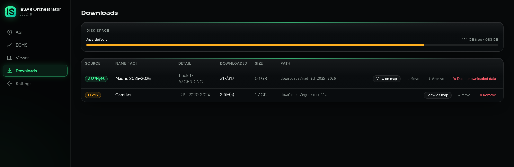
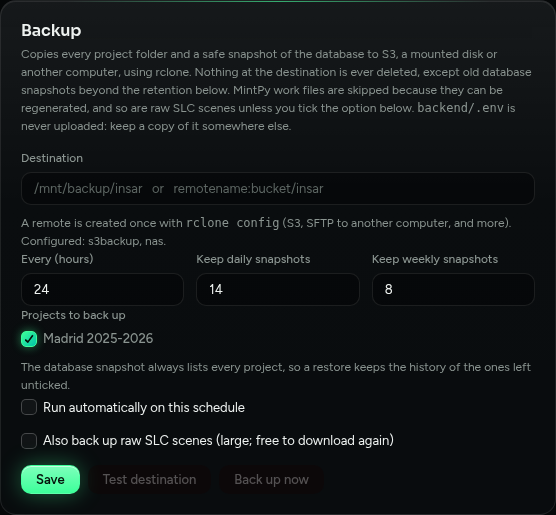

# Your files: disks, backup and archive

## Where things are

| What | Where |
|---|---|
| Projects, batches, jobs | `backend/insar_app.db` |
| Settings and the encryption key | `backend/.env` |
| ASF projects | `backend/downloads/<project name>/` |
| EGMS downloads | `backend/downloads/egms/<name>/` |

To change the default folder for everything, set `DOWNLOADS_DIR=/path/to/folder` in `backend/.env`.

## Disks, space and moving



- **Choose a disk.** When you create a project or an EGMS download, the *Storage destination* menu lists the disks the computer can see.
- **Move.** On **Downloads**, press **Move**, pick the destination and wait for the progress bar. The disk must already be mounted (a network share works). One move at a time.
- **Free up space.** *Delete downloaded data* removes a project's interferograms, **MintPy results** and `provenance.json`, and keeps the batch and job history. (Raw SLC scenes are separate.) It is refused while MintPy is running. *Remove* deletes an EGMS download (it asks whether to delete the files too).

## Automatic backup

Install [rclone](https://rclone.org/install/) on the machine that runs the app, then open **Settings, Backup**.



1. **Destination**: a folder on a mounted disk (`/mnt/backup/insar`), or `remote:path` for a remote you create once with `rclone config` (S3 and compatible, or SFTP to another computer over SSH or a VPN).
2. **Test destination** checks it is writable. **Back up now** runs one immediately. **Run automatically** repeats it on a schedule.
3. Tick the projects to include under *Projects to back up*. New projects are included by default.

What a run does: it copies every project folder, then a consistent snapshot of the database. Nothing at the destination is deleted, except old database snapshots beyond the daily and weekly retention you set. If any project fails to copy, the snapshot is not uploaded, so a restored database never points at missing files.

Skipped on purpose: MintPy work files (they can be rebuilt) and raw SLC scenes (they cost no HyP3 credits, only time and bandwidth) unless you tick *Also back up raw SLC scenes*. `backend/.env` is **never** uploaded because it holds the key to your credentials: keep a copy somewhere else.

The same thing runs from cron or a systemd timer:

```bash
cd backend && .venv/bin/python -m app.backup --to s3backup:my-bucket/insar
```

## Archive a finished project

Press **Archive** on the **Downloads** page and give a destination (prefilled with your backup one). The app copies the whole folder (MintPy results and SLC included), verifies it with `rclone check`, confirms nothing changed meanwhile, and only then deletes the local files. If anything fails, the local files stay as they were.

An archived project cannot be viewed, updated or run until you press **Restore**, which copies it back and verifies it. The archive copy is never removed.

Verification compares sizes and, where the destination supports it, checksums. Some destinations share no checksum with a local disk (SFTP without `md5sum`): then only sizes are compared.

## Backup by hand

1. **The database.** `make backup-db` writes a safe copy to `backups/`, even while the app runs. Do not copy `insar_app.db` yourself: recent changes may sit in a side file.
2. **`backend/.env`**, kept apart from the database.
3. **Project folders.** After the crop the originals are gone, so a project folder is the only copy of that data. It is small. EGMS downloads can be fetched again.

## Restore

Stop the app, copy the backup over `backend/insar_app.db`, delete `insar_app.db-wal` and `insar_app.db-shm` if they exist, put `backend/.env` and the folders back, and start the app. On a new computer run `./setup.sh` first: it never overwrites an existing `backend/.env`.
