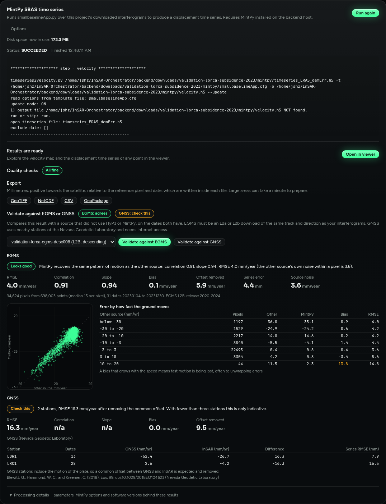

# Check and export a result

MintPy always produces a time series, whether or not it is right. This page covers what the app gives you to tell the two apart, to change how a run is made, and to take the result into other software. All of it is in the **MintPy SBAS time series** card of the project, under the list of jobs.

## Change how MintPy runs

The **Options** button opens a form with the settings that most change a result. Leaving every field on its default runs MintPy with its own defaults, plus two steps of this app that are described below: the correction of unwrapping errors and a stricter mask. What you set is saved with the run (see **Processing details**), so a changed run can always be told apart from a default one.

| Option | When to change it |
|---|---|
| **Ionosphere correction** (NISAR projects only) | On by default for NISAR, which is far more sensitive to it than Sentinel-1. `no` leaves it out. |
| **Troposphere correction** | `height_correlation` needs no weather data. `no` leaves the correction out. |
| **Remove a ramp** | Only for data with a clear plane or surface over the whole area. It also removes real long-wavelength motion. |
| **DEM error correction** | Turn it off for a flat area with a good DEM. |
| **Unwrapping error correction** | On by default when the network allows it (each date joined to two or more others). `no` leaves the phases as they came. See below. |
| **Longest temporal and perpendicular baseline, most neighbours** | Drop long or distant interferograms before the inversion. |
| **Inversion weights, lowest temporal coherence** | A higher temporal coherence gives a cleaner map with more gaps. |
| **Correct the fading bias of short interferograms** | Off by default. Needs one interferogram over the whole period (*Add one pair over the whole period* in the pair planner). See *Fading bias* below. |
| **Drop pixels whose triplets do not close** | On by default for a network of short interferograms only; off when the network has long pairs. `yes` and `no` force it. See *The mask* below. |
| **Lowest mean spatial coherence** | Not applied unless set. Also drops the pixels whose coherence, averaged over the interferograms, is under it. |

### Reference point

Every value in the result is relative to one pixel, the **reference point**, and to a reference date. If that pixel moves, the whole map is shifted by the same amount. Left empty, the app picks the most coherent pixel away from the edge, which can sit inside a subsiding area. If you know a stable place, type its latitude and longitude. It must be inside the processed area.

## Quality checks

When a run finishes, the app reads the files MintPy left behind and lists what looks fine and what deserves a look: the interferogram network (connected, and how thin), the mean coherence, how many pixels survive the temporal coherence mask, unwrapping inconsistencies, the time covered (a series of a few weeks gives a velocity extrapolated to a year, which is very noisy), the residual of the inversion (and any date that fits much worse than the rest), and the reference pixel (coherent, inside the area, away from the edge).

The thresholds are rules of thumb for Sentinel-1 with 80 m pixels. A green list means nothing obvious is wrong. It does not prove the numbers are right: for that, validate.

### Unwrapping errors

An unwrapped interferogram can be off by a whole number of cycles in a patch, which is 28 mm for Sentinel-1. Three interferograms that join three dates in a loop must add up to zero, so a patch that is one cycle off in one of them shows as a loop that is off by exactly one cycle.

Before the inversion the app looks at every loop of every pixel, finds the smallest set of whole-cycle corrections that makes them close, and applies it where the answer is beyond doubt. It writes the corrected phases beside the original ones, which are never changed. MintPy's own routine for this needs a layer that HyP3 whole-scene products do not carry and stops with an error on them, which is why the app does it itself.

It is deliberately cautious:

- **A noisy pixel is left alone.** Where a loop is off by about half a cycle, rounding it to a whole cycle is a coin toss. On real stacks most of the pixels counted as "not closing" are of this kind, and adding cycles to them moved them away from EGMS. They are corrected only when they sit inside a patch that was corrected and show the same error.
- **An ambiguous pixel is left alone.** An interferogram that is part of a single loop cannot be told from the other two of that loop.
- **An error shared by every interferogram of a date** closes perfectly and cannot be seen by any method of this kind.

The check **Pixels with triplets that do not close** then says what share of the kept pixels was corrected, what share is noise, and what share could not be resolved. With errors of known size put into two real stacks, 98% of the affected pixels were put back exactly and under 1% were changed wrongly. On those stacks as they came, about 1% of the pixels had such errors: expect this step to matter where a river, a fault or a strip of crops cuts the area in pieces, and to change little elsewhere.

### The mask

MintPy keeps a pixel when its temporal coherence passes a threshold. With the three or so interferograms per date of a usual network that test is weak: on the test stacks of this app 99.8% of the pixels passed it, the noisy ones included. The loops of interferograms are a sharper test, so the app also leaves out the pixels whose loops do not close and could not be corrected.

On a one-year stack over a subsiding basin, compared with EGMS, those pixels were 7.5% of what MintPy kept. Their velocities were off by 5.8 mm/year against 4.0 for the rest, and one in eleven was more than 10 mm/year off, against one in fifty. A low mean spatial coherence marked a further, weaker tail of the same kind; what counts as low depends on the ground, so that limit is yours to set.

**With long pairs the mask is off by default.** In the same basin, after about three months and one year pairs were added to the network, the pixels this mask would have dropped (7.7%) agreed with EGMS as well as the rest (3.71 against 3.66 mm/year): the long pairs constrain them. The mask then only loses pixels, so it is left to you (`yes`). The correction of unwrapping errors, and this judgement of the loops, look at the short interferograms only (up to four revisit intervals), because the triplets of a long pair are noisy by construction.

The values of a dropped pixel stay in the files, only the mask changes, and MintPy's own mask is kept beside it as `maskTempCoh_mintpy.h5`. The checks **Pixels kept** and **Pixels with triplets that do not close** say how many were dropped and why. The reference point is never dropped.

### Fast motion in long interferograms

Between two neighbouring pixels the unwrapped phase of a good interferogram changes by well under half a cycle. Where the ground moves fast, an interferogram of three months or a year reaches that: the phase aliases, unwrapping loses whole cycles, and the motion comes out smaller than it is, whatever the coherence. The check **Fast motion in long interferograms** gives the share of the kept pixels that jump by more than half a cycle to a neighbour in the three longest interferograms in use. Interferograms of 12 to 36 days almost never do.

This was measured in a subsiding basin (Lorca, descending track 8, 2023) against the GNSS station LOR1, which sits in the bowl and records -65 mm/year along the line of sight:

| Network | InSAR velocity at LOR1 | Pixels with a step above half a cycle |
|---|---|---|
| 87 short pairs (up to 36 days) | -26.7 mm/year | 0.02% (36-day pairs) |
| plus 24 pairs of about 3 months | -13.8 mm/year | 2.5% (3-month pairs) |
| plus those and one of a year | -14.1 mm/year | 4.9% (the 1-year pair) |

Over the whole basin the long pairs lowered the difference with EGMS (RMS 4.15 to 3.66 mm/year) because most of the area moves slowly, and there they help. In the bowl they make it worse, and even the short pairs reach only 40% of the GNSS velocity at 80 m resolution. So **a velocity above a few centimetres a year, such as a subsidence bowl, is not recovered by this chain**: take it as a lower bound and check it against GNSS. If the check warns and the zone matters, process the area without long pairs (untick *Add long pairs* in the pair planner).

### A plane on every date

Orbit errors and large scale atmosphere or ionosphere add a different plane to every date of the series. Over a year they add up to a false slope across the whole area. The check **Plane carried by each date** fits a plane to the kept pixels on every date and gives the median edge to edge change, in millimetres. It warns from 10 mm.

This was measured over slow farmland (Valladolid, ascending track 1, 2023) that does not move. The planes were 10 to 30 mm across the 50 by 28 km area, the check read 16 mm, and the velocity was off by 7 mm/year RMS against EGMS and by 23 mm/year at the GNSS station ARDU. With a linear ramp removed from every date the check read 0.2 mm, the RMS fell to 5.1 mm/year and ARDU to 10 mm/year from the GNSS value.

A plane also fits real motion that covers the whole area, so the check does not say which it is. If you know the ground is stable over its whole extent, set **Remove a ramp** to *linear*. If it moves everywhere, as a large subsiding basin does, leave it off: the ramp would delete the signal.

### Precision with distance

The standard error MintPy gives for a pixel is relative to the reference point. It cannot tell you how well the **difference between two places** is known, and that is usually the question: does the bowl sink faster than the field beside it? The noise of an InSAR date is mostly atmosphere, which is nearly the same for two pixels 300 m apart and unrelated for two pixels 30 km apart. So a nearby difference is known far better than either pixel is known relative to a distant reference.

The app measures this from your own result. For every date it takes what the straight line of each pixel did not explain and measures how much it differs between pixels, as a function of the distance between them. Those per-date figures, combined with the weights a least squares line gives each date, give the precision of a difference of velocity at each distance. It also corrects for noise that lasts from one date to the next.

Two curves are shown, under the quality checks and in the report:

- **Precision**: what the noise of the dates allows. It is the least the error can be. Errors that grow steadily with time, such as the fading bias, are taken by the straight line and are not in it.
- **Seen in the map**: how much the velocities themselves differ at that distance. It holds the noise, those steady errors and any real difference in motion.

Over ground that does not deform, the truth is near the second curve. Over deforming ground it lies between the two. To judge whether two places move differently, compare the difference of their velocities with the value at the distance between them, not with the error of each pixel.

How it was checked: on simulated stacks with known noise the precision curve matches the true spread of the velocity errors within 4% (11% short when the noise lasts from date to date). Against EGMS on a one-year stack over a subsiding basin, the real differences grow with distance as the curve does and are about twice as large, on a stack with a measured fading bias of 2 mm/year. **GeoTIFF precision**, in the export menu, is the map of this figure for every pixel relative to the reference point.

### Fading bias

One of the checks, **Fading bias of short interferograms**, looks for an error that a clean-looking result can hide. The phases of three interferograms that form a loop (dates 1-2, 2-3 and 1-3) should add up to zero. Over vegetated or farmed ground they do not, by a small amount that has the same sign date after date and is largest in the shortest interferograms. A series built from short interferograms adds it up into a velocity that is off by millimetres per year.

The check measures it from the loops of your own network: how much faster the shortest interferograms make the ground appear to move than the ones that span the loop. It reports the median over the area, the value in the least and in the most coherent third of the pixels (fading is a property of ground that changes, so that is where it shows), and the share of pixels with a bias of their own.

- It is a **lower bound**. The longer interferograms it is measured against are biased too, only less.
- It states its own **noise floor**: with loops of a few weeks one pixel is measured to a couple of mm/year, so a smaller bias goes unseen.
- It is measured relative to the most coherent pixels of the area, which fade least.
- It needs closed loops: each date paired with the next two or more.

On the test projects of this app a quiet city showed none, and a farmed basin showed about -2 mm/year over the area and -5 mm/year in its least coherent third, the same on the ascending and on the descending track. If it shows in yours, there are three things to try, none of them a sure cure (see below).

#### What the literature says, and what was measured here

The bias is documented and not specific to this app. Ansari, De Zan and Parizzi (2021) showed that multilooked short interferograms carry a short-lived signal that decays with the time they span; Zheng, Fattahi and others (2022) showed that velocities from subsets of a network with different longest temporal baselines differ by centimetres per year over a dry lake, and proposed estimating the bias from generalized closure phases; Maghsoudi, Hooper, Wright, Lazecky and Ansari (2022) found it largest over crops and forest (where it mimics subsidence) and nearly zero over cities. The ways to deal with it are:

- **Phase linking** (estimating each date's phase from all the interferograms of a pixel), which is almost insensitive to it. It needs the complex images, which HyP3 does not give, so this app cannot do it.
- **Correcting the short interferograms from their own loop closures** (Maghsoudi and others): the bias of an interferogram two or three steps long is a constant fraction (they found 0.47 and 0.31 over Turkey) of the sum of the biases of the steps it spans, so the closures give a linear system for the bias of each step. The constants come from one interferogram over the whole period, taken to have no bias. **This app implements it**, as the option *Correct the fading bias of short interferograms*.
- **Using longer interferograms** (the pair planner's *Add long pairs*), which helps where the ground keeps coherence and is a practice rather than a published correction.

What was measured here, in a farmed and subsiding basin (Lorca, descending track 8, 2023) against EGMS (34,600 pixels) and two GNSS stations:

| Network | RMS against EGMS | Bias in the subsiding bands (-30 to -3 mm/year) | LOR1 (in the bowl; GNSS -64.9) | LRC1 (slow; GNSS -4.1) |
|---|---|---|---|---|
| 87 short pairs, as they come | 4.15 mm/year | +0.4 to +1.7 | -26.7 | -3.6 |
| the same, with the fading bias corrected | 4.42 | +3.4 to +3.7 | -13.1 | -2.3 |
| plus 24 pairs of 3 months | 3.70 | +2.1 to +2.8 | -13.8 | -5.8 |

The constants the correction found there (a1 = 0.45, a2 = 0.26) are almost the published ones, an independent sign that the method is measuring the same effect. But removing it, like adding long pairs, took about 2 to 3 mm/year of subsidence off the whole basin and moved the velocity away from both references. The most likely reading is that the basin's real subsidence, which is large and fast and was already underestimated, is part of what the closures call bias there, or that the references (EGMS has its own processing) disagree with this chain by that much. It is not settled, so the correction is **off by default**. Use it where the ground is slow and covered by crops or forest, and compare its result with an independent source.

## Validate against EGMS or GNSS

**Validate against EGMS or GNSS** compares your result with a source that did not use HyP3 or MintPy.

- **EGMS** needs an L2a or L2b download (see [Get data](get-data.md)) of the **same track and direction** as your interferograms, so that the acquisition dates match. The download can be larger than your area: only the points inside the processed area are read, however many there are. It takes a minute or two.
- **GNSS** uses stations of the Nevada Geodetic Laboratory that recorded over the whole period inside your area, and needs internet access. Each station's east, north and up motion is projected onto the satellite's line of sight at that pixel first.

### How the comparison is made

1. Only dates both sources have are used. A constant between two series is a matter of reference, not of agreement, so the mean difference of each pixel is removed before the series are compared.
2. EGMS points are put into the 80 m MintPy pixel they fall in and their **median** is compared. Pixels with fewer than three points are left out.
3. Each source is fitted with a straight line (mm/year).
4. MintPy is relative to its reference pixel and EGMS to GNSS, so each side has its own zero. The common offset is estimated as the median difference and removed. The result reports both the **offset removed** and the errors after removing it.

### Reading the result

| Figure | Meaning |
|---|---|
| **RMSE** | Typical size of the velocity difference, in mm/year, after removing the offset. |
| **Correlation, slope** | Whether MintPy shows the same pattern of motion (correlation near 1) and the same amplitude (slope near 1). The slope is fitted allowing for noise in both sources, so the noise of EGMS or GNSS does not pull it below 1. |
| **Bias** | Average MintPy minus the other source, after removing the offset. |
| **Offset removed** | Where each source puts its zero. Large values point to the reference pixel. |
| **Series error** | Typical error of the displacement series, in mm. |
| **Source noise** | How much EGMS points inside one pixel disagree. No comparison can be better than this. |
| **Error by how fast the ground moves** | A bias that grows with speed means the fastest motion is being lost, often to unwrapping errors. |

The verdict is a plain reading of these numbers: *Looks good*, *Check this* or *Not reliable*. Where the ground barely moves, the correlation is meaningless, so the verdict then rests on the size of the error and says so. A good result there shows the result is quiet where the ground is quiet, not that it recovers real motion.

GNSS stations include the motion of their tectonic plate, so a common offset is expected. With one station that offset cannot be told apart from a disagreement, and with fewer than three the result is only indicative. A station can also be on a building or a rock that does not move like the 80 m pixel around it.

### How far to trust the stated error

MintPy states a standard error for every velocity, from the fit of a straight line to the series. That fit treats the noise of each date as independent, but atmospheric noise is correlated in time, so the stated error is usually too small. When you validate against EGMS the app measures it: it divides the difference with EGMS by the stated error in every pixel and compares the spread with what a correct error would give.

| Figure | Meaning |
|---|---|
| **Stated error, observed spread** | The median error MintPy reports, and the robust spread of the difference with EGMS (a few badly unwrapped pixels do not move it). |
| **Within 1 sigma, within 2 sigma** | The share of pixels that agree with EGMS within one and two stated errors. A correct error gives 68% and 95%. |
| **Scale** | By how much the stated error is too small. It is never below 1: a few thousand pixels of one area do not justify smaller error bars. |

EGMS has errors of its own and states none per pixel here, so the scale is a little high, never low. The **GeoTIFF realistic error** export is the stated error multiplied by this scale, and it appears only once the check has run.

### Tie the map to GNSS

MintPy gives velocity relative to its reference pixel, which it assumes does not move. If it does, the whole map is shifted by that amount, and GNSS stations inside the area say by how much. When you validate against GNSS the app also estimates that shift:

1. The jumps of known equipment changes are taken out of each station's series first. The Nevada Geodetic Laboratory lists the day of every antenna or receiver change, and such a change moves the series by millimetres without the ground moving. Earthquakes in the list are left in, because where they moved the ground InSAR saw it too, and the card names the stations they could have touched.
2. Each station's velocity is then estimated over the days of the run. With two years of data or more the estimator is MIDAS (Blewitt et al., 2016): the median of the slopes between positions one year apart, which the seasons and a jump nobody listed do not move. With less it is a straight line, as MintPy's velocity is, so both carry the same share of the seasons. The error is never below 1 mm/year.
3. The map is read at the station's pixel as the median of the 3 x 3 pixels around it, and the station's east, north and up velocities are projected onto the line of sight with that pixel's own geometry.
4. The motion of the tectonic plate is removed from the station's horizontal velocity, because InSAR tied to a nearby pixel does not see it. The app uses the ITRF2014 plate motion model (Altamimi et al., 2017) and picks the plate that matches the stations, so the calibrated map is relative to the rigid plate, the frame EGMS uses. If the stations move more than 5 mm/year relative to the plate, the card says so: that is a plate boundary zone, local horizontal motion, or a record too short for a horizontal velocity.
5. The shift is the average of the differences, weighted by the errors. With two or more stations the app leaves each out in turn, estimates the shift from the others and checks it on the one left out. If that does not reduce the error against stations the shift has not seen, the shift is reported and **not applied**.

With one station there is nothing to test the shift against, and the card says so. A station with a gap in its record is compared only over the dates it has, the table shows what share of the period that is, and a station that covers less than half of the period is not used for the shift. When GNSS is compared with InSAR date by date, the station's position on an acquisition date is the median of the week around it, which halves the GNSS noise. The **GeoTIFF tied to GNSS** export is the velocity plus the shift, and it appears only when the stations confirmed it.

If MintPy runs again, the numbers describe a result that is gone, and the card says so until you validate again.

## Report

**Open the report** gives one page that says what the result is, how it was made and how far to trust it: the period, the track, the pairs and how they were chosen, the corrections applied, the reference point, the velocity map and the pair network as figures, every quality check, the comparison with EGMS and GNSS when they were run, the limits of what the result can say, and what to cite. It ends with the full record as JSON for a script to read.

The page has no outside dependencies, so it can be saved (**Save as HTML**), printed to PDF from the browser and attached to a paper as supplementary material. A validation made before MintPy last ran is left out, because it describes a result that is gone.

## Export

The **Export** buttons download the result in formats other software reads. Values are in millimetres, positive towards the satellite, relative to the reference pixel and date, which are written inside each file.

| Format | Contents | Open it with |
|---|---|---|
| **GeoTIFF** | The velocity map (mm/year), cloud optimised, in the result's own coordinate system. Other layers (standard error, coherence, mask, the series with one band per date) are available through the API. Two more appear after a validation: the velocity tied to GNSS and the realistic error. | QGIS, ArcGIS, GDAL |
| **NetCDF** | Velocity, standard error, coherences and the displacement cube (`time`, `y`, `x`), CF conventions. | `xarray.open_dataset`, QGIS, GDAL |
| **CSV** | One row per kept pixel: latitude, longitude, velocity, standard error, coherences and one column per date. A comment block at the top states what the numbers are. | A spreadsheet, or `pandas.read_csv(path, comment="#")` |
| **GeoPackage** | A point layer in WGS84 with the same attributes. | QGIS, any GIS or database |

Pixels that MintPy's temporal coherence mask rejects are left out (the `masked` option of the API changes that). Pixel positions are the pixel **centres**. Files are built once and reused until MintPy runs again, and a GeoPackage of a large area can take a minute to prepare.

### From a script

The same things are available from the API, for example `GET /api/projects/<id>/mintpy/export?format=geotiff&layer=velocity_std`. The layers are `velocity`, `velocity_std`, `velocity_precision`, `temporal_coherence`, `coherence`, `mask` and `timeseries`, plus `velocity_calibrated` and `velocity_std_calibrated` once the GNSS and EGMS checks justify them. The interactive documentation of the API is at `/docs` on the backend.
