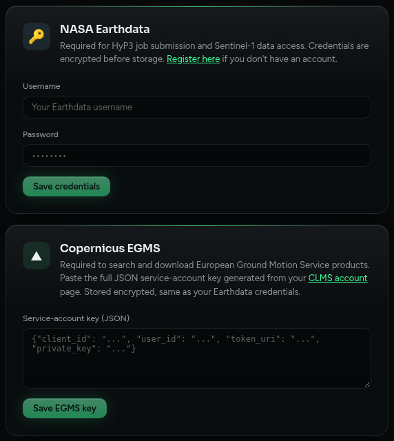

# Credentials

Open **Settings** and fill in only what you will use.



| For | Enter | Get it from |
|---|---|---|
| ASF / HyP3 | Earthdata username and password | A free account at [urs.earthdata.nasa.gov](https://urs.earthdata.nasa.gov/users/new) |
| EGMS | The full JSON key | A service-account key from your account at [land.copernicus.eu](https://land.copernicus.eu) |
| ERA5 correction | Nothing. The weather data comes from a public archive | Optional fallback: a `~/.cdsapirc` file from a free account at [cds.climate.copernicus.eu](https://cds.climate.copernicus.eu) |

## How they are stored

Earthdata and EGMS credentials are stored **encrypted**. The key that opens them is `SECRET_KEY` in `backend/.env`, which `./setup.sh` creates. Do not delete or change it. If it is lost, the app says *"Stored credentials could not be decrypted"* and you enter them again.

## ERA5 weather data (no login needed)

MintPy corrects the troposphere with ERA5 weather data, one file per acquisition date. The app takes it from **ARCO-ERA5**, Google's public copy of the same Copernicus ERA5 reanalysis. It needs no account and no queue, and takes about 15 seconds per date. The values match the files the Copernicus Climate Data Store (CDS) produces, within the file's own rounding (checked on a real date: 0.0008 K on temperature). Processing details records which source was used.

The CDS is only a **fallback**, used if the archive cannot be reached. It works through a shared queue that can hold one request for hours, so a run that needs 30 files can take a day. To enable it, create `~/.cdsapirc` on the machine that runs the app (with the container: `data/home/.cdsapirc`):

```
url: https://cds.climate.copernicus.eu/api
key: <your personal access token>
```

You may also have to accept the ERA5 licence once on the dataset's page.

**If neither source works** the app notices before the run, **leaves the ERA5 correction out, runs everything else and shows a warning** in the MintPy panel and in *Processing details*. (Letting MintPy try would stop late in the run with a division-by-zero error that does not mention the cause.) Run again to apply the correction. ERA5 files already in the project's `mintpy/ERA5` folder are reused.
