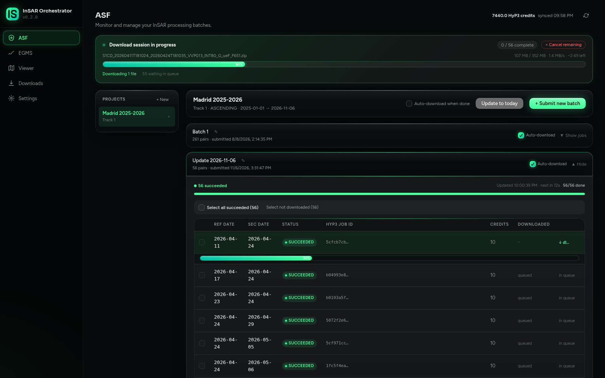
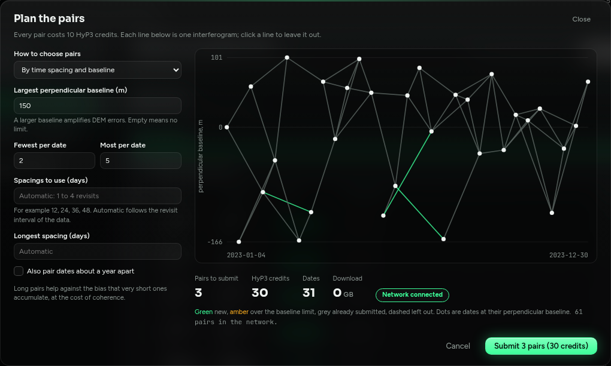
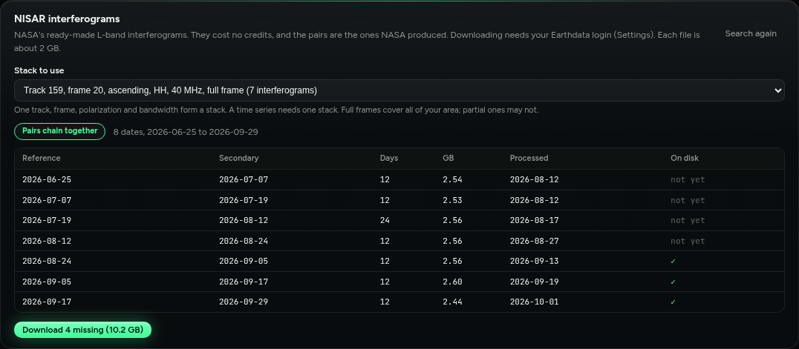
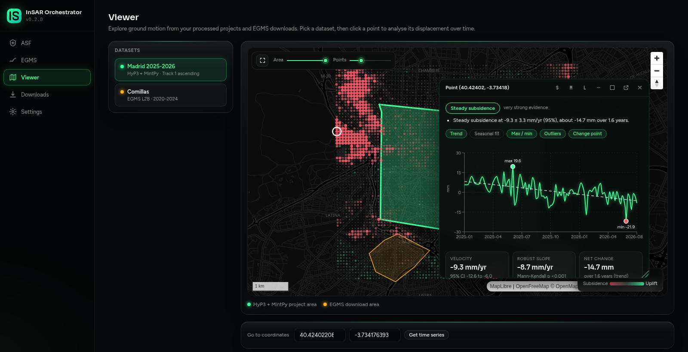
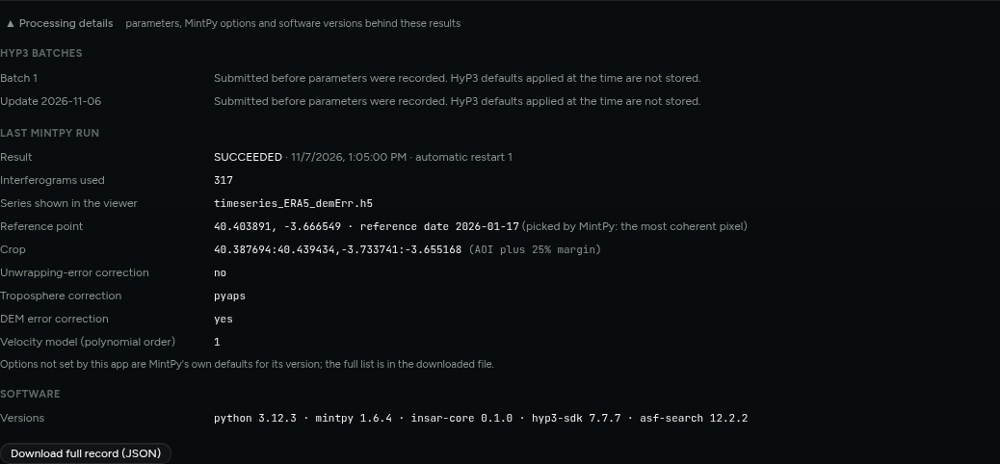

# Get ground-motion data: ASF, NISAR or EGMS

Three ways to get ground motion. Whichever you use, the result opens in the **Viewer**.

| | **ASF (Sentinel-1)** | **NISAR** | **EGMS** |
|---|---|---|---|
| What you get | Your own time series, computed from Sentinel-1 images | Your own time series, from NASA's ready-made L-band interferograms | Ready-made products from Copernicus |
| Where | Anywhere Sentinel-1 flies | Where NISAR has flown since mid 2026 | Europe |
| You choose | Dates, satellite track, area, how the pairs are chosen | Dates, area, which stack of interferograms | Area, product level, release |
| Needs | Earthdata account, HyP3 credits, MintPy | Earthdata account, MintPy | The EGMS key |
| Takes | HyP3 processing, then MintPy | A download of about 2 GB per interferogram, then MintPy | Just the download |

Set up the [credentials](credentials.md) first.

## The ASF way

1. **ASF page, "+ New".** Name the project, set the dates, draw the area, pick a satellite track (the app shows how many scenes each has) and confirm. *Max temporal neighbors* is how many following images each image is paired with (3 is a good start).
2. **Submit new batch.** This opens the pair planner (see below). HyP3 processes one interferogram per pair in the cloud. Each pair uses HyP3 credits (your balance is at the top right). Statuses update on their own.
3. **Download.** Tick *Auto-download when done*, or download from the table. HyP3 keeps a result online only until its expiry date. Once it is on your disk it is yours.
4. **Run MintPy.** The panel at the bottom of the project. It **crops** the data to your area, then builds the time series.
5. **Open in viewer.**

**Add new dates later.** *Update to today* extends the project to today and offers only the pairs that do not exist yet, so nothing is paid twice.

### Whole scenes or bursts

In step 1, *Source of interferograms* offers two ways to process Sentinel-1 through HyP3:

| | Whole scenes (INSAR_GAMMA) | By bursts (INSAR_ISCE_BURST) |
|---|---|---|
| What is processed | The whole scene, about 250 x 170 km | Only the bursts over your area, strips of about 20 x 85 km |
| Credits per pair at 80 m | 10 | 1 for up to four bursts, 5 for up to twelve, 10 for up to fifteen |
| Limit | None | The area must fit in 15 bursts of one pass |
| Extra | | The connected components of the unwrapping, which MintPy uses to mask regions the unwrapper could not tie together |

For an area of a few kilometres the burst way gives the same dates and the same pair network for a tenth of the credits. The planner shows the price of your own area before anything is sent. If the area needs more than 15 bursts, the planner says so and the whole-scene way is the one to use.

### Choose the pairs

**Submit new batch** shows the whole network before anything is sent. Each dot is an acquisition, placed by its date and its **perpendicular baseline** (how far apart the two orbits were), and each line is one interferogram. The panel says how many pairs are new, what they cost in credits, and whether the network is connected. A pair you do not want can be left out by clicking its line.

| How to choose | What it does |
|---|---|
| **Next N acquisitions** | Each image is paired with the next N. Two optional additions: **Add long pairs** (one image about three months later and one about a year later; off by default, see below) and **Add one pair over the whole period** (one extra pair, which fixes the constants of the fading bias correction). It never removes a pair, but it counts those over the baseline limit you set. |
| **By time spacing and baseline** | Pairs are picked at multiples of the revisit interval (12, 24, 36 and 48 days for a 12 day satellite, or the spacings you give), kept under a perpendicular baseline limit, and every date is brought to between a minimum and a maximum number of interferograms. Dates that nothing connects are joined, and the panel tells you when a pair had to break your limits to do it. |

*Also pair dates about a year apart* adds pairs a year long, which help against the bias that only short interferograms accumulate, at the cost of coherence. Pairs already submitted stay in the network (so connectivity is judged on everything that exists) but cost nothing. What you chose is saved with the batch in **Processing details**.

**Why the long pairs are off by default.** An interferogram of a few days over soil or vegetation carries a small phase that is not motion and always has the same sign. A network made only of short pairs adds it up into millimetres per year of false motion (the fading bias, see [Check and export](check-and-export.md)). A pair of months or a year hardly has it, so adding them pulls the series back where the ground keeps coherence that long. But over ground that moves fast (a subsidence bowl) a long interferogram aliases: unwrapping loses whole cycles and the motion comes out smaller. In a subsiding basin checked against GNSS and EGMS the 3-month pairs made the velocity in the bowl smaller and the agreement there worse, and the literature does not use long pairs as the standard cure (it estimates the phases from all the interferograms, or corrects the short ones from their loop closures). Tick them for a slow area with crops or forest, where the fading bias is what matters; the quality check *Fast motion in long interferograms* tells you if they cost you motion. The app takes, among the images near each span, the one with the smallest perpendicular baseline.

A large perpendicular baseline does not stop an interferogram from working, but it amplifies DEM errors, and every pair costs credits, so a limit around 150 m is a sensible start.

### What the crop does

A HyP3 image covers hundreds of kilometres, but your area is a few. Before MintPy runs, the app keeps a window around your area (25% margin) and **deletes the original downloads**: a project goes from tens of GB to a few hundred MB.

The crop cannot be redone. For a different area, create a new project and download again, which only works while HyP3 still hosts the results.

## The NISAR way

NISAR is the NASA and ISRO radar satellite. Its public data began in mid 2026, and NASA publishes ready-made interferograms (the **GUNW** product), so there is nothing to process and no credits to spend. L-band (24 cm) keeps its coherence over fields and vegetation much better than Sentinel-1's C-band.

1. **ASF page, "+ New".** In *Source of interferograms* choose **NISAR GUNW**, then name the project, set the dates, draw the area and choose where to store the files. There is no track to pick.
2. The project shows a **NISAR interferograms** panel. It searches the ASF archive and groups what it finds into **stacks**: granules of one track, frame, polarization and bandwidth, which is what a time series needs. Choose one stack. A full frame covers all of your area; a partial one may not.
3. **Download.** The panel lists every interferogram (which two dates, how many days apart, its size, when NASA processed it) and downloads the missing ones, one at a time. Each is about 2 GB, and downloading needs your Earthdata login. Where NASA processed a pair more than once, the newest version is used.
4. **Run MintPy.** The same panel as for Sentinel-1. MintPy reads the files directly, with the unwrapped phase, coherence and connected components from each one. The app builds the elevation model MintPy needs from the free Copernicus 30 m DEM, and applies the **ionosphere correction** from the layer each NISAR interferogram carries, because L-band is much more sensitive to it. In **Options** you can turn it off.

Things to know:

- **The pairs are NASA's.** You cannot choose them, and a stack can have gaps or dates that nothing connects. The panel and the quality checks say so.
- **A few weeks is not a time series.** NISAR data is new, so a project may cover only a few interferograms. The quality checks warn when the series is short, because a velocity in mm/year extrapolated from a few weeks is very noisy. Look at the displacement itself.
- **The data is provisional.** NASA is still calibrating it. A run over Lorca with four dates in 2026 gave a deformation pattern that correlates with the Sentinel-1 bowl (r = 0.73 at 560 m after the ionosphere correction), but the large-scale ramps in L-band interferograms are strong, and with so few dates it is a check that the chain works, not a measurement to rely on.
- Validation against EGMS only applies to periods EGMS covers (up to 2024), which NISAR does not reach yet. GNSS validation works.

## The EGMS way

1. **EGMS page.** Draw the area (up to 5° x 5°), choose a *Level* and press **Search products**:
   - **L2a / L2b**: a displacement time series for every point.
   - **L3**: velocity maps only (vertical and east-west), no time series.
2. Tick the products you want and press **Download**.

## Look at the result

In the **Viewer**, pick a dataset on the left and click a point. Its time series opens in a window you can resize, move or open in a separate browser window.

For ASF projects the viewer shows the series MintPy computed the velocity from, that is the corrected one (for example `timeseries_ERA5_demErr.h5`). What the numbers mean: [Reading a time series](time-series-analysis.md). To change how MintPy runs, check a result against EGMS or GNSS, or export it to GeoTIFF, NetCDF, CSV or GeoPackage: [Check and export a result](check-and-export.md).

## If the app restarts

An update, a crash or a reboot does not lose work. A few seconds after it starts, the app picks up where it left off:

- A batch still being sent to HyP3 is resumed. Before sending anything the app asks HyP3 which jobs already exist, so an accepted pair is adopted, not submitted twice (that would spend credits twice). If HyP3 cannot be asked, nothing is resubmitted; *Update to today* offers whatever is missing.
- Finished results never downloaded, in batches with *Auto-download* on, are queued again (results older than about two weeks are skipped: HyP3 has deleted them).
- A MintPy run cut short is restarted once. If it is interrupted again it shows **INTERRUPTED** and waits for you to press *Run again*.

Downloads you queued by hand, and SLC or EGMS downloads in progress, are not restored: start them again.

## How a result was produced

Open **Processing details** under the MintPy panel.

It shows the HyP3 parameters of every batch, the pairing rule, the crop, the options MintPy used (reference point, corrections, DEM error) and the software versions. *Download full record* saves everything as JSON, including every pair and its HyP3 job id.

The **reference point** is chosen by the app, not left to MintPy: the most coherent pixel (averaged over 3 x 3 pixels) that is valid in every interferogram and not on the border of the area, so the same data always gives the same reference. MintPy's own automatic choice is random among the coherent pixels and can fall on the border, which breaks its tropospheric correction. A reference you set yourself in the options is kept.

Every MintPy run also writes this record to `provenance.json` in the project folder, so backups and archives explain themselves. Batches submitted before this feature have no recorded parameters. Options the app does not set are MintPy's defaults for the installed version, and the record states each resolved value.
