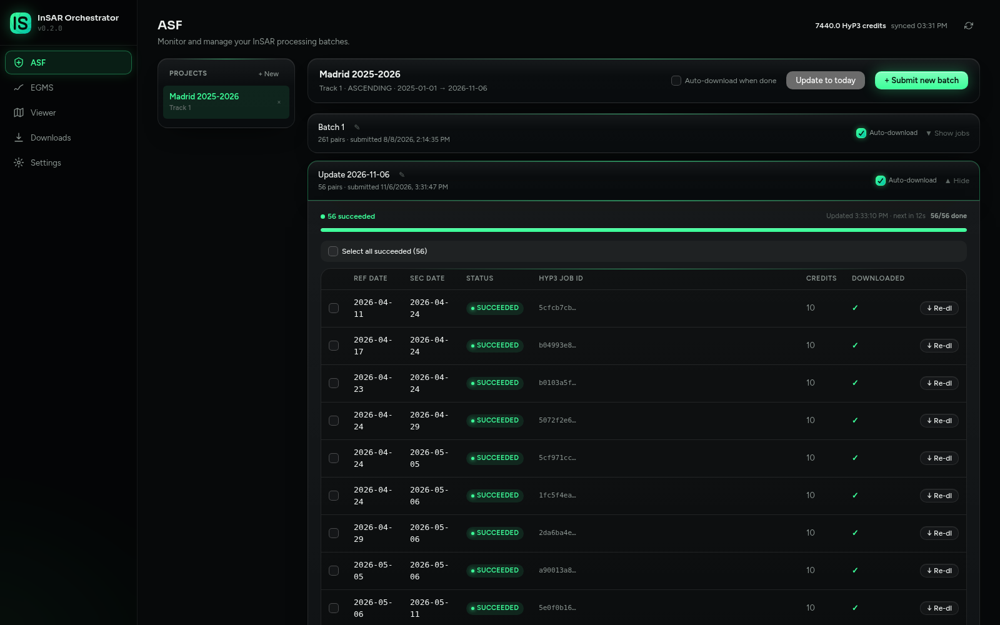
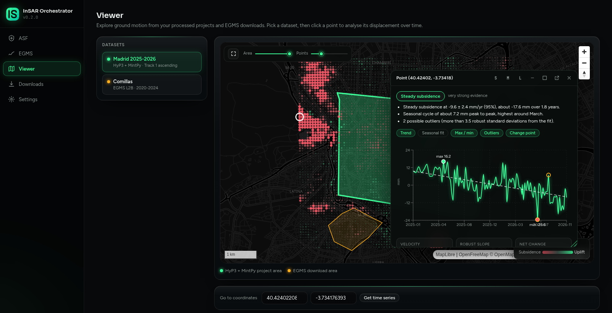
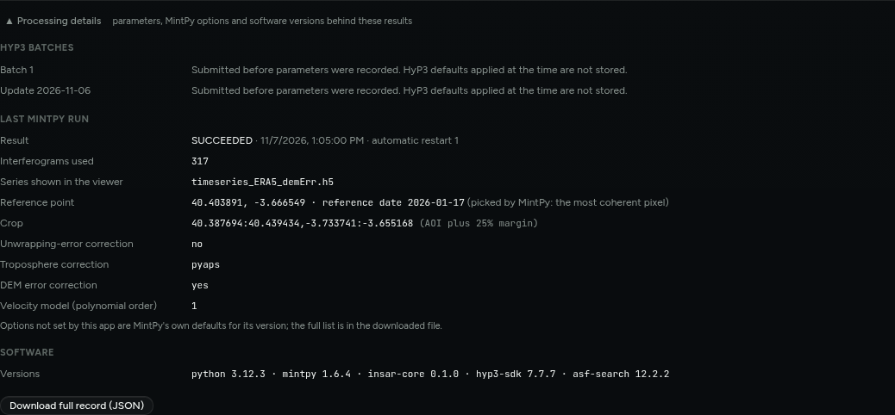

# Get ground-motion data: ASF or EGMS

Two ways to get ground motion. Either way, the result opens in the **Viewer**.

| | **ASF** | **EGMS** |
|---|---|---|
| What you get | Your own time series, computed from Sentinel-1 images | Ready-made products from Copernicus |
| Where | Anywhere Sentinel-1 flies | Europe |
| You choose | Dates, satellite track, area | Area, product level, release |
| Needs | Earthdata account, HyP3 credits, MintPy | The EGMS key |
| Takes | HyP3 processing, then MintPy | Just the download |

Set up the [credentials](credentials.md) first.

## The ASF way

1. **ASF page, "+ New".** Name the project, set the dates, draw the area, pick a satellite track (the app shows how many scenes each has) and confirm. *Max temporal neighbors* is how many following images each image is paired with (3 is a good start).
2. **Submit new batch.** HyP3 processes one interferogram per pair in the cloud. Each pair uses HyP3 credits (your balance is at the top right). Statuses update on their own.
3. **Download.** Tick *Auto-download when done*, or download from the table. HyP3 keeps a result online only until its expiry date. Once it is on your disk it is yours.
4. **Run MintPy.** The panel at the bottom of the project. It **crops** the data to your area, then builds the time series.
5. **Open in viewer.**

**Add new dates later.** *Update to today* extends the project to today and offers only the pairs that do not exist yet, so nothing is paid twice.

### What the crop does

A HyP3 image covers hundreds of kilometres, but your area is a few. Before MintPy runs, the app keeps a window around your area (25% margin) and **deletes the original downloads**: a project goes from tens of GB to a few hundred MB.

The crop cannot be redone. For a different area, create a new project and download again, which only works while HyP3 still hosts the results.

## The EGMS way

1. **EGMS page.** Draw the area (up to 5° x 5°), choose a *Level* and press **Search products**:
   - **L2a / L2b**: a displacement time series for every point.
   - **L3**: velocity maps only (vertical and east-west), no time series.
2. Tick the products you want and press **Download**.

## Look at the result

In the **Viewer**, pick a dataset on the left and click a point. Its time series opens in a window you can resize, move or open in a separate browser window.

For ASF projects the viewer shows the series MintPy computed the velocity from, that is the corrected one (for example `timeseries_ERA5_demErr.h5`). What the numbers mean: [Reading a time series](time-series-analysis.md).

## If the app restarts

An update, a crash or a reboot does not lose work. A few seconds after it starts, the app picks up where it left off:

- A batch still being sent to HyP3 is resumed. Before sending anything the app asks HyP3 which jobs already exist, so an accepted pair is adopted, not submitted twice (that would spend credits twice). If HyP3 cannot be asked, nothing is resubmitted; *Update to today* offers whatever is missing.
- Finished results never downloaded, in batches with *Auto-download* on, are queued again (results older than about two weeks are skipped: HyP3 has deleted them).
- A MintPy run cut short is restarted once. If it is interrupted again it shows **INTERRUPTED** and waits for you to press *Run again*.

Downloads you queued by hand, and SLC or EGMS downloads in progress, are not restored: start them again.

## How a result was produced

Open **Processing details** under the MintPy panel.

It shows the HyP3 parameters of every batch, the pairing rule, the crop, the options MintPy used (reference point, corrections, DEM error) and the software versions. *Download full record* saves everything as JSON, including every pair and its HyP3 job id.

Every MintPy run also writes this record to `provenance.json` in the project folder, so backups and archives explain themselves. Batches submitted before this feature have no recorded parameters. Options the app does not set are MintPy's defaults for the installed version, and the record states each resolved value.
