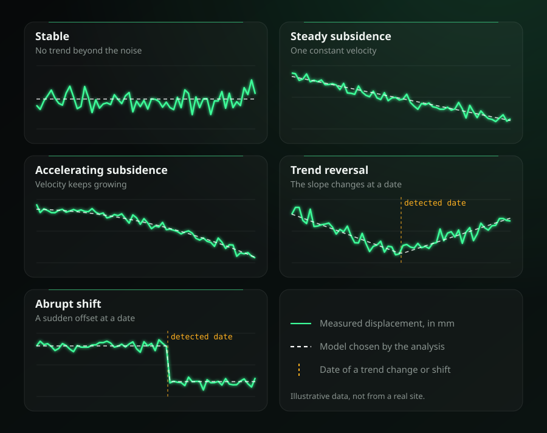

# Reading a time series

When you click a point in the viewer, its displacement series opens in a window with a short statistical summary next to the chart. This page explains what each part means and how it is computed, so you can judge how much to trust it.



## What the window shows

| Item | What it tells you |
|---|---|
| **Pattern label** | The overall behaviour of the series, one of the five patterns below, with the evidence behind it. |
| **Sentences under the label** | The same result in plain language: velocities, the date of a change, seasonality, outliers and gaps. |
| **Velocity** | Slope of a straight line through the whole record, with a 95% interval. |
| **Robust slope** | The Theil-Sen slope, which ignores outliers, and the Mann-Kendall p-value. |
| **Net change** | How much the fitted trend moved between the first and the last date. |
| **Maximum, Minimum** | Highest and lowest displacement, with their dates. |
| **Seasonality** | Peak to peak size of the annual cycle and the month when it is highest. |
| **Noise** | Scatter of the data around the chosen model (RMS of the residuals) and the number of outliers. |
| **Sampling** | Number of dates, the usual interval between them and how many gaps there are. |

Five layers can be switched on the chart: the **trend** (dashed), the **seasonal fit**, the **max / min** markers, the **outliers** and the **change point** (an amber vertical line).

## The five patterns

The series is fitted with five models and the simplest adequate one wins:

| Pattern | Model | Labels you can see |
|---|---|---|
| Stable | a constant | *Stable* |
| Linear | a straight line | *Steady subsidence*, *Steady uplift* |
| Quadratic | a parabola (velocity changes gradually) | *Accelerating*, *Decelerating*, *Trend reversal*, *Onset of ...*, *Stabilising* |
| Change in trend | two straight lines joined at one date | the same labels as the quadratic pattern, with the date |
| Abrupt shift | one straight line with a jump at one date | *Abrupt shift* |

Negative velocity is subsidence (the ground moves away from the satellite) and positive is uplift.

For the two patterns where the velocity changes, the label compares the velocity before and after. A velocity smaller than 0.5 mm/yr, or smaller than its own 95% uncertainty if that is larger, counts as "no motion":

- *Trend reversal*: both velocities are real and have opposite signs.
- *Onset of subsidence / uplift*: it was stable and now it moves.
- *Stabilising*: it was moving and now it is stable.
- *Accelerating / Decelerating*: same direction, faster or slower.
- *Non-linear (small)*: the variation is within the noise.

## How the pattern is chosen

1. **Candidates.** Every model above is fitted by least squares. For the change in trend and the abrupt shift, every possible date in the middle 76% of the record is tried (the first and last 12% are excluded, and at least 4 observations must remain on each side), and the best date is kept.
2. **Ranking.** Models are compared with the Bayesian information criterion (BIC), which rewards a good fit and penalises extra parameters (the break date counts as one). A more complex model is only accepted when its BIC is at least 6 lower than the simpler one, which is the usual threshold for *strong* evidence. The window shows "strong evidence" from 6 and "very strong evidence" from 10.
3. **Seasonality.** When the record spans at least 1.5 years and has at least 12 dates, an annual cycle (one sine and one cosine) is added to the trend, but only if that improves the BIC by at least 6. It is then fitted together with the chosen model, so it does not leak into the trend.

This follows the classification idea of Berti et al. (2013), who sort persistent scatterer series into linear, quadratic, bilinear and discontinuous behaviours, but it ranks models with the BIC instead of a chain of significance tests.

## How the numbers are computed

- **Velocity.** Ordinary least squares on a single straight line, in mm/yr. When the pattern is not linear this is the *mean* velocity over the record, which is why the card is then labelled "Mean velocity".
- **Uncertainty.** The standard error of the slope, enlarged because consecutive InSAR observations are not independent: the effective number of observations is `n (1 - r) / (1 + r)`, where `r` is the lag-1 autocorrelation of the residuals (only positive values widen the interval). The window shows a 95% interval (1.96 standard errors).
- **Robust slope.** The median of the slopes between all pairs of dates (Theil-Sen). One bad observation barely moves it. Series longer than 600 dates are thinned evenly for this step.
- **Mann-Kendall.** A rank test for whether the series tends to rise or fall. It does not assume a straight line. A small p-value (below 0.05) means a monotonic tendency exists.
- **Net change.** The fitted trend at the last date minus the fitted trend at the first date, without the seasonal part.
- **Outliers.** Observations whose residual is more than 3.5 robust standard deviations from the model, using the median absolute deviation so that the outliers do not inflate their own yardstick.
- **Gaps.** An interval between consecutive dates longer than 3 times the median interval.
- **Minimum size.** Fewer than 8 valid observations give no summary, only the chart.

## Things to keep in mind

- These are descriptive statistics of **one pixel**. They say how that series behaves, not why.
- InSAR series carry atmospheric noise, and every value is relative to a **reference point**, so small trends (about 1 mm/yr or less) should be read with care, and a uniform offset across a whole scene is not a real signal.
- The **break date** is an estimate and can be off by a few acquisitions, more so when the change is subtle, the data are noisy or there are gaps.
- Only **one** change is searched. A series with several changes is described by its largest one.
- A short record (under 1.5 years) cannot separate the seasonal cycle from the trend, and the window says so.
- The velocity colours on the map are relative to the **median** of the dataset, while the numbers here are the absolute values of that point.

## Using it from Python

The analysis lives in the library and only needs numpy:

```python
from insar_core.analysis import analyze_time_series

result = analyze_time_series(dates, values_mm)  # "YYYYMMDD" or ISO dates; None if fewer than 8 valid points

print(result["model"]["label"])            # e.g. "Trend reversal"
print(result["model"]["break_date"])       # e.g. "2025-11-18"
print(result["velocity"]["ols_mm_yr"])
print(result["narrative"])                 # the plain-language sentences
```

The result is a plain dictionary, ready to serialize as JSON. The backend adds it to both time series endpoints as the `analysis` field:

- `GET /api/egms/downloads/{id}/points/{point_id}/timeseries`
- `GET /api/projects/{id}/mintpy/timeseries?lat=&lon=`

Besides the values in the table above, `series` holds the cleaned and date-sorted data with the fitted `fit` and `trend` curves, all with the same length, which is what the chart draws.

It takes about 10 ms for a series of 200 dates and about 100 ms for 800, because all candidate break dates are fitted in one batched solve.

## References

- Berti, M., Corsini, A., Franceschini, S., Iannacone, J. P. (2013). [Automated classification of Persistent Scatterers Interferometry time series](https://nhess.copernicus.org/articles/13/1945/2013/). Natural Hazards and Earth System Sciences.
- Urgilez Vinueza, A. et al. (2022). [A new method to detect changes in displacement rates of slow-moving landslides using InSAR time series](https://research.tudelft.nl/en/publications/a-new-method-to-detect-changes-in-displacement-rates-of-slow-movi). Landslides. Piecewise linear fits to detect changes in rate.
- [ISPRS Annals X-4/W8-2025](https://isprs-annals.copernicus.org/articles/X-4-W8-2025/227/2026/isprs-annals-X-4-W8-2025-227-2026.pdf). The difference between an abrupt change point and a gradual turning point, and the effect of gaps and autocorrelation.
- MintPy [`timeseries2velocity`](https://manpages.ubuntu.com/manpages/kinetic/en/man1/mintpy-timeseries2velocity.1.html). Linear, periodic and step terms in a velocity fit, and bootstrap uncertainty.
